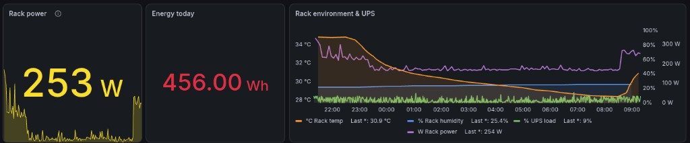
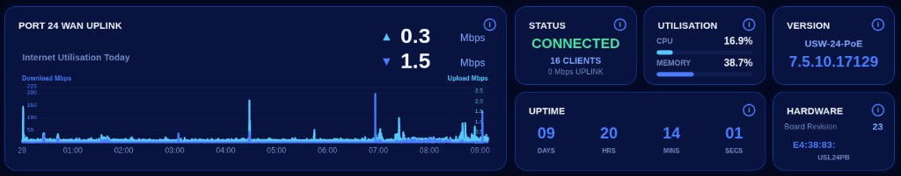
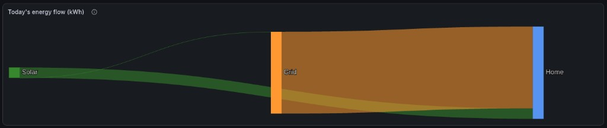

# Grafana kiosk dashboards

Responsive Grafana dashboards designed for compact kiosk displays, including
UniFi switch monitoring, daily energy flow, and computer-room telemetry.

Created by [CustomDeedsAustralia](https://github.com/CustomDeedsAustralia).

## Gallery

### Computer room



Combines current rack power, energy used today, rack temperature and humidity,
UPS load, and historical rack power in one compact view.

### UniFi switch



Recreates the visual style of a UniFi device display using live uplink
throughput, connection state, client count, CPU and memory utilisation, uptime,
hardware information, and firmware version.

### Energy flow



Uses an Apache ECharts Sankey diagram to show solar energy consumed by the
home, solar energy exported to the grid, and energy imported from the grid.

The screenshots show one installation. Device names, values, and available
metrics will differ in other environments.

## Design target

The dashboards use Grafana's 24-column grid and eight grid rows. They were
designed for wide, short kiosk displays, including a 1480×320 viewport. The
UniFi visualization switches to a compact two-row layout below 420 pixels in
height.

For a fullscreen browser:

```text
http://GRAFANA_HOST:3000/d/DASHBOARD_UID?kiosk
```

On Windows, press `Ctrl+0` for 100% zoom and `F11` for fullscreen. Chromium can
also hide scrollbars:

```powershell
Start-Process chrome.exe -ArgumentList `
  "--kiosk", `
  "--hide-scrollbars", `
  "http://GRAFANA_HOST:3000/d/kiosk-unifi-switch?kiosk"
```

## Included dashboards

### UniFi switch

Files are in `dashboards/unifi-usw24/`.

- `build.js` creates the Grafana API payload.
- `echarts.js` contains the responsive visualization.
- `dashboard.json` is generated by the build.

Expected metrics:

- Uplink receive and transmit rates in Mbit/s
- CPU and memory utilisation in percent
- Connected client count
- Uplink speed in Mbit/s
- Device connection state
- Uptime represented as an ISO timestamp
- Firmware update entity with an `installed_version_str` field

The example was designed around Home Assistant's UniFi integration, but any
InfluxDB series with equivalent fields can be mapped.

### Energy flow

Files are in `dashboards/energy-flow/`.

- `build.js` creates the dashboard payload.
- `query.flux` is a configurable Flux query template.
- `echarts.js` creates the Sankey diagram.
- `dashboard.json` is generated by the build.

It expects cumulative daily values for solar generation, grid export, and grid
import.

### Computer room

Files are in `dashboards/computer-room/`.

- `build.js` creates the dashboard payload.
- `dashboard.json` is generated by the build.

It expects rack power, rack energy today, temperature, humidity, and UPS load
metrics. When using the optional builder, the warning and critical rack-power
thresholds can be configured in `.env`.

## Requirements

To use the included dashboard JSON:

- Grafana with an InfluxDB data source configured for Flux
- InfluxDB 2.x, or another Flux-compatible endpoint
- [Business Charts](https://grafana.com/grafana/plugins/volkovlabs-echarts-panel/)
  (formerly Apache ECharts) for the UniFi and energy-flow dashboards

Node.js, npm, and the PowerShell deployment script are not required to use or
adapt the dashboards. Node.js 18 or newer is only needed for the optional
source-builder workflow. The builders have no third-party npm dependencies.
A Grafana service-account token is only needed when using the optional
deployment script.

The queries assume the Home Assistant InfluxDB schema:

- `_field == "value"` for numeric sensor states
- `domain == "sensor"` for sensor entities
- `entity_id` stored without the Home Assistant domain prefix

For example, Home Assistant's `sensor.rack_temperature` commonly appears in
InfluxDB as `entity_id == "rack_temperature"`.

## Recommended workflow: Cursor and Grafana MCP

The easiest way to adapt these dashboards is to open the repository in
[Cursor](https://cursor.com/) and connect the
[Grafana MCP server](https://github.com/grafana/mcp-grafana). Cursor can use
Grafana MCP to inspect available data sources and metrics, map them to the
dashboard configuration, update the code, and publish the finished dashboard
to Grafana. This removes much of the manual work involved in editing Flux,
embedded panel code, and dashboard JSON.

## Make your own dashboard

To make your own dashboard, the following steps loosely define the approach:

1. Use Cursor with Grafana MCP to inspect the metrics available in your
   Grafana data sources.
2. Choose the included dashboard that most closely matches what you want to
   create.
3. Map its example metrics and queries to your own entities or series.
4. Adjust the titles, layout, colours, units, thresholds, and time range.
5. Use standard Grafana panels where possible and `echarts.js` when the design
   requires custom drawing.
6. Preview the dashboard in Grafana and refine it for your target display.
7. Save the finished dashboard JSON as the starting point for future changes.

Cursor and Grafana MCP can perform this workflow directly against Grafana, so
the build scripts are optional. If you prefer dashboard-as-code, copy a
dashboard directory, update its `build.js` and configuration values, add the
builder to `build-all.js`, then run `node build-all.js`.

The `writeDashboard` and `fluxString` helpers in `build-utils.js` are shared by
the optional builders. `fluxString` safely quotes configurable names inside
Flux queries.

### Adapting the UniFi display

The optional UniFi builder separates data mapping from presentation:

- `.env` maps your entities and hardware labels.
- `build.js` creates Flux queries from that mapping.
- `echarts.js` renders the data and responds to panel dimensions.

To monitor another switch or uplink with the builder, change the `UNIFI_*`
values in `.env`. If you work directly through Cursor and Grafana MCP, map
those values in the dashboard queries instead.

### Supporting another data source

The included queries use Flux. Prometheus, SQL, and other Grafana data sources
return different frame structures. Keep the visual layout, replace the
targets in `build.js`, and adjust frame extraction near the top of
`echarts.js`.

## Troubleshooting

### Dashboard shows no data

- Confirm the Grafana data-source UID, not just its name.
- Confirm the InfluxDB bucket and retention period.
- Check entity IDs in Grafana Explore.
- Remove the `sensor.` prefix when the Home Assistant schema stores it
  separately in the `domain` tag.
- Confirm numeric states use `_field == "value"`.

### Business Charts panel is missing

Install the Business Charts plugin, restart Grafana if required, and rebuild
or reload the dashboard.

### UniFi uptime shows zero

The included query expects the uptime entity state to be an ISO date/time
representing the last boot. If your exporter provides elapsed seconds, replace
query `D` in `dashboards/unifi-usw24/build.js`.

### Firmware is blank

The example expects a Home Assistant update entity recorded as
`installed_version_str`. Inspect the entity's fields in InfluxDB and adjust
query `E` if your schema differs.

### Lines stack vertically at one timestamp

InfluxDB frames can include `_start`, `_stop`, and `_time`. The ECharts code
must use `_time` for individual sample timestamps. The included implementation
already handles this distinction.

### Dashboard still scrolls on a 320-pixel display

- Use the `?kiosk` URL parameter.
- Reset browser zoom to 100%.
- Use browser fullscreen.
- Try `--hide-scrollbars` with Chromium.
- Reduce `gridPos.h` from `8` to `7` if the browser reserves extra vertical
  space.

## License

This project is licensed under the [MIT License](LICENSE).
